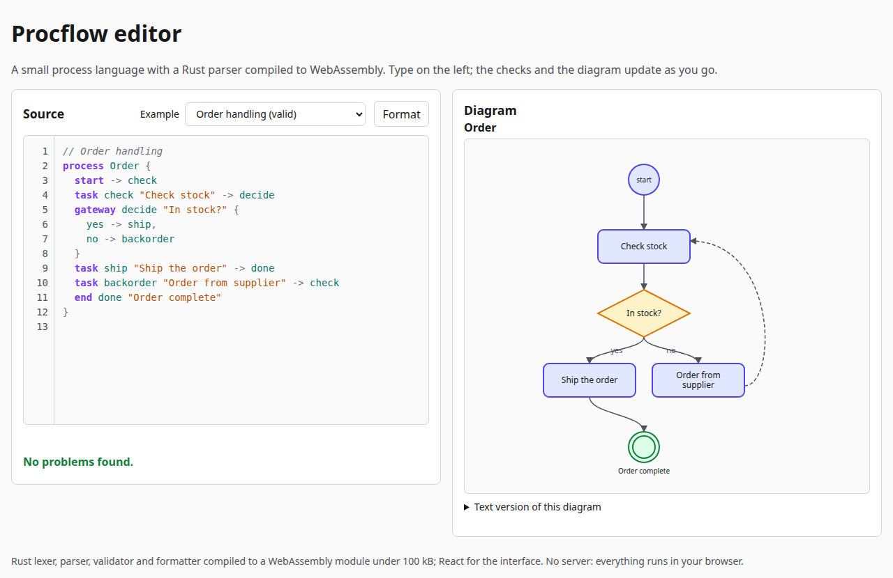

# mini-language-lab: Procflow, a small language with real tooling

[](https://github.com/codenlighten/mini-language-lab/actions/workflows/ci.yml)

**[Open the live editor](https://codenlighten.github.io/mini-language-lab/)** (GitHub Pages, published by this repository's CI after the tests pass; everything runs in your browser).



A tiny process-description language (steps, decisions, loops) with the tooling an editor needs: a lexer, a parser that keeps going after errors, a validator with "did you mean" hints, a comment-preserving formatter and a diagram, written in **Rust**, compiled to **WebAssembly** and driving a **React + TypeScript** browser editor.

It shows how to build language tooling that holds up on messy input, and how to hand it to a JavaScript front end without getting the offsets wrong.

```
process Order {
  start -> check
  task check "Check stock" -> decide
  gateway decide "In stock?" {
    yes -> ship,
    no -> backorder
  }
  task ship "Ship the order" -> done
  task backorder "Order from supplier" -> check
  end done "Order complete"
}
```

## Run it

Needs Rust with the `wasm32-unknown-unknown` target and Node 22. It was built and tested with Rust 1.98; the crates declare 1.80 as the minimum, which I have not tested.

```bash
cargo test                                                  # the language tools and the WASM glue
cd web && npm ci && npm run build:wasm && npm run dev       # the editor at http://localhost:5173
```

`npm test` runs the unit tests against the real compiled module. `npm run test:e2e` drives the editor in a browser: first run `npx playwright install chromium` once (add `--with-deps` on a bare Linux machine), or set `PW_CHANNEL=chrome` to use an installed Chrome.

## The language

A file holds one or more `process` blocks. Inside one: `start -> step`, `task name "label" -> next`, `gateway name "label" { branch -> step, ... }` and `end name "label"`. Names are ASCII letters, digits and `_`; labels are optional strings; `//` starts a comment. Steps may be used before they are declared.

| Code | Meaning |
|---|---|
| E001 | Stray characters (a whole run is one report, not one per character) |
| E002, E003 | Unclosed string; unknown escape |
| E010 to E015 | Expected a name; expected `->` or `{`; unexpected token; reserved word used as a name; missing `,` or `}`; missing closing `}` |
| E101 | Duplicate step name |
| E102 | Unknown step, with a suggestion when one name is clearly closest ("did you mean `ship`?") |
| E103, E104, E105 | No `start`; more than one `start`; no `end` |
| E106, E107 | Task without a next step; gateway with fewer than two branches |
| E108 | A reachable step that can never reach an `end` (the process could run forever) |
| E110 | Duplicate process name |
| E900 | Source larger than 1 MiB (refused, not analyzed) |
| W201 | Step that can never be reached from `start` |
| W202 | Two branches of one gateway with the same label |

## What this shows

- **Parser that recovers.** One run reports every syntax problem it can find, not just the first, then carries on with the next item. There is no nesting, so no recursion and no stack-depth risk.
- **No misleading follow-on errors.** A single mistake is not allowed to produce a cascade. Checks that need a complete process (missing start or end, missing next step, too few branches) are skipped for a process that has a syntax error, and the whole-graph checks (unreachable steps, endless loops) are skipped when a name does not resolve or a step has no outgoing edge. Each rule exists because verification showed a real cascade without it.
- **Offsets a JavaScript editor can use.** Rust slices by UTF-8 byte, JavaScript by UTF-16 code unit. A multi-byte character, or an emoji, makes them disagree. Every position leaving the Rust side is converted once (`core/src/source.rs`), and tests check that every token and diagnostic selects the same text by byte and by UTF-16 range.
- **A formatter that never loses a comment.** A comment on its own line stays above the next item; a comment at the end of a line stays there; a comment inside a gateway's braces moves just below the gateway. Tests check the comment count and idempotence on thousands of generated programs.
- **Fuzzed, not just example-tested.** Deterministic fuzz tests run about 12,000 random and mutated programs, plus every prefix and every single-character deletion of the sample. They check for panics, spans in bounds and on character boundaries, valid JSON, stable formatting and no lost comments.
- **A small WASM boundary.** The module has no dependencies, uses a plain C interface (no `wasm-bindgen`) and is about 94 kB (release build, `opt-level = "s"`, LTO, no `wasm-opt`). The only `unsafe` code is the memory hand-over in `wasm/src/lib.rs`, with documented preconditions; the core crate has none.
- **An editor that stays accessible.** A real `<textarea>` sits over a highlighted `<pre>`, so selection, undo, input methods and screen readers behave natively. Problems are keyboard-reachable buttons that select the exact range; the diagram has a text description and a text version; colour is never the only signal.

## Layout

```
core/    procflow-core: lexer, parser, validator, formatter, JSON output (no dependencies)
wasm/    procflow-wasm: C-ABI entry points over the core
web/     the editor: React, TypeScript, Vite; highlight and diagram layout are pure, tested functions
```

## Tests

On a Linux machine, from a copy of the working tree (clean, at the commit before this README was added): `cargo fmt --check` and `cargo clippy -- -D warnings` are clean; 79 Rust tests, 37 unit tests (which load the real compiled WebAssembly, not a stand-in) and 13 browser tests (Chrome) pass. GitHub Actions runs the same steps from a clean checkout; it found two problems that my machine could not (listed below).

Long step labels were later made to wrap (2026-11-26). With that change 45 unit tests and 14 browser tests pass on a second Linux machine, and eight deliberate breaks of the new code were each caught, two of them only after I strengthened the tests.

### What running it found

Building this turned up problems that no review had pointed out. Each is fixed and guarded by a test:

- "sihp" for "ship" was not suggested, because plain edit distance counts a swapped pair as two edits. The distance now counts it as one.
- A run of stray characters (for example `42`) produced one error per character. It is now one report.
- After a syntax error, "missing next step", "unreachable" and "can never finish" appeared as noise. Completeness checks now wait for a clean parse.
- A single typo made its predecessor look endless and everything behind it look unreachable. Whole-graph checks now wait until every name resolves.
- A test of the WebAssembly glue compared the returned length with text it had read using that same length, so it could not fail. It now compares against the core's output.
- My own "mistakes tour" example hid two of the errors it advertised, because the tour mixed unrelated mistakes in one process.
- On a fresh clone the build failed, because Git does not keep the empty `web/public` folder the build script copies into. GitHub's CI found it; my own machine never could, because copying the working tree copied the empty folder too.
- On GitHub's browser the page scrolled sideways on phone-width screens: the example dropdown (259 px wide) was wider than the screen. Chrome with overlay scrollbars hid it. The browser tests now check widths of 320, 343 (a 360 px phone with a classic scrollbar), 360 and 390 px.
- A screenshot of the live editor showed its own default example cut off ("Order from suppl…"). Step labels now wrap onto a second line, with a test that the text stays inside its box.
- Publishing the live demo showed two layout faults that every test had passed over: the default diagram ran off the side of its panel, and after one typo the cut-off steps stacked in a single line with the arrows through them. The flow now runs top to bottom, a cut-off part keeps its own shape, and tests check that the diagram fits at desktop and phone widths. Screenshots of the fix then showed a backward arrow running through a neighbouring step, fixed by placing its ends on the outside of the row.

### Independent review

An independent AI review (a different model, asked to find real bugs only) of the core and the WASM glue found four issues. All four were real:

| Finding | Fix | Guarded by |
|---|---|---|
| A 17 kB program with a very long unresolved name made the typo-suggestion helper allocate hundreds of MB (it kept the whole distance table), enough to crash a browser tab | Three-row algorithm; names over 64 characters are never compared | A test with 30,000-character names that must finish in seconds; a test that long names get no suggestion |
| The formatter attached a comment to the wrong item when several items shared a line | A comment trails an item only if nothing but spaces lies between them | A format test with the reviewer's input |
| The WASM entry points took raw pointers without being marked `unsafe` | `unsafe extern "C"` with documented safety preconditions | Compile-time (callers must opt in) |
| A task with no next step caused follow-on "unreachable" and "endless" reports | The graph counts as incomplete, so whole-graph checks are skipped | A test that a missing next step yields exactly one diagnostic |

Checking the fixes also showed that the review's fourth suggestion was too broad for gateways (a gateway with one branch still has its edge), so the rule applies only to a gateway with no branches, and one of my own length checks turned out to be redundant and was removed.

### Deliberate breaks

Each change below was made on its own, the suite run, and the code restored. Every break failed the test named here (some failed more than one).

| Break | Failed |
|---|---|
| UTF-16 columns counted per character instead of per code unit | `a_surrogate_pair_counts_as_two_columns`, `json_offsets_select_the_same_text_as_the_byte_spans`, two fuzz tests |
| Unreachable steps never reported | `w201_unreachable_steps` and 2 more |
| "Did you mean" never suggests | `e102_undefined_target_with_a_close_suggestion` |
| Formatter drops comments | 9 formatting tests, including the comment-count tests |
| JSON writer does not escape quotes | `json_is_valid_for_awkward_text_in_messages_and_labels`, two fuzz tests |
| Completeness checks run after syntax errors | `no_follow_on_errors_after_a_syntax_error...`, `unterminated_string_is_reported_once_per_string` |
| Duplicate names not detected | `e101_duplicate_names`, one more |
| Gateway with one branch accepted | `e107_gateway_needs_two_branches` |
| Endless loops not detected | `e108_a_loop_with_no_way_out`, one more |
| Formatter forgets the commas between branches | `messy_input_is_normalised` and 4 more |
| WASM `analyze` reports the wrong length / analyzes the wrong text (two breaks) | `analyze_returns_exactly_the_cores_json_through_the_buffer` |
| WASM `format_source` reports the wrong length | `format_returns_text_or_a_clear_code` |
| An unresolved name no longer suppresses graph checks | `a_typo_in_a_name_does_not_cause_unreachable_or_endless_loop_reports` |
| A task without a next step no longer marks the graph incomplete | `a_task_without_a_next_step_does_not_cause...` |
| A gateway with no branches no longer marks the graph incomplete | `a_gateway_with_no_branches_does_not_cause...` |
| Typo suggestions compare names of any length | `a_very_long_name_cannot_exhaust_memory_in_the_did_you_mean_search`, one more |
| Formatter attaches any same-line comment to the previous item | `a_comment_stays_with_the_construct_it_follows...` |
| A zero-width marker splits an emoji in the editor | `never splits an emoji...`, `displayRange > widens over a whole emoji...` |
| The WASM wrapper reads output through a view taken before the call (stale after memory growth) | `survives memory growth...`, `refuses input over 1 MiB...` |
| Clicking a problem selects by column instead of UTF-16 offset | both browser tests about selecting a range |
| The diagram draws only the first process | the browser test of the mistakes tour |
| The example dropdown allowed to be wider than the screen | the sideways-scroll tests at 320 px and 343 px |
| Layout rows ignore the shape of a cut-off part | `keeps the shape of a disconnected part...`, `gives a disconnected loop an entry...` |
| Ends of backward edges not moved to the outside | `puts the ends of backward edges on the right of their row...` |
| A cut-off loop given no entry point | `gives a disconnected loop an entry...` |
| A step looping to itself drawn as an invisible line | `makes a step that loops to itself visible` |
| Backward curve not swung clear of the steps | `draws forward edges downwards and backward edges round the right` |
| Short rows not centred | `puts each step in the row given by its depth...` |
| Diagram not allowed to shrink to its panel | the browser tests that the default diagram fits its panel |
| Columns spaced too widely for the panel | `is narrow enough to show the example...` and the 390 px fit test |

## Limits

- It is a small language: one level of structure, ASCII names, no expressions, no data, no BPMN or other standard. It demonstrates tooling techniques; it is not a modelling product.
- The whole text is re-analyzed on every keystroke. That is instant at editor sizes and is capped at 1 MiB, but it is not incremental.
- Step labels wrap by counting characters, not measuring them: a task gets two lines of 17, decisions and ends one, and a line of unusually wide characters could still overflow.
- The diagram layout is simple (rows by distance from `start`, no edge-crossing minimisation: a long edge can pass behind a step, as can one of two backward arrows leaving or entering the same row) and the diagram is read-only. It shrinks to fit its panel down to three quarters size, then scrolls.
- The editor is not a language server and does not offer completion, rename or go-to-definition.
- The browser tests ran in Chrome and in GitHub Actions' Chromium, not in Firefox or Safari. Keyboard use and automated checks were done; a screen reader was not used.
- The WebAssembly module is single-threaded and the next call overwrites its output buffer (the protocol is documented in `wasm/src/lib.rs`). It is not run through `wasm-opt`.
- Timings are not claimed: no performance benchmark was run.

## Dependencies

Rust: none (the crates have no dependencies). Web: React and React DOM at run time; Vite, TypeScript, Vitest, Playwright and oxlint for development. All are public packages and none of their code is copied here.

## Licence

MIT. See `LICENSE`.
